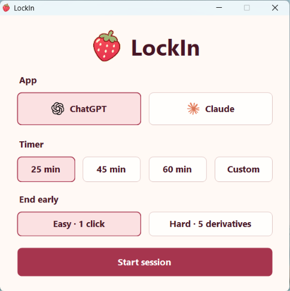

  

<h1 align="center">LockIn</h1>

A Windows study timer for ChatGPT and Claude.

  <picture>
    <source media="(prefers-color-scheme: dark)" srcset="assets/chatgpt-dark.png">
    
  </picture>
  &nbsp;&nbsp;
  

  <a href="https://github.com/MashrafeeAryan/LockIn/releases/latest/download/LockIn-Setup.exe"><strong>Download for Windows</strong></a>

  

<!-- Add the demo video here. -->

## Quick start

1. Download and run [**LockIn-Setup.exe**](https://github.com/MashrafeeAryan/LockIn/releases/latest/download/LockIn-Setup.exe), then click **OK** to add LockIn to your desktop.
2. Open the ChatGPT or Claude desktop app and sign in.
3. Open **LockIn** from your desktop. Pick your app, a timer, and **Easy** or **Hard**.
4. Click **Start session**.

Click the strawberry in the bottom-right corner to see the timer or stop. **Easy** stops in one click. **Hard** asks for five correct derivatives.
